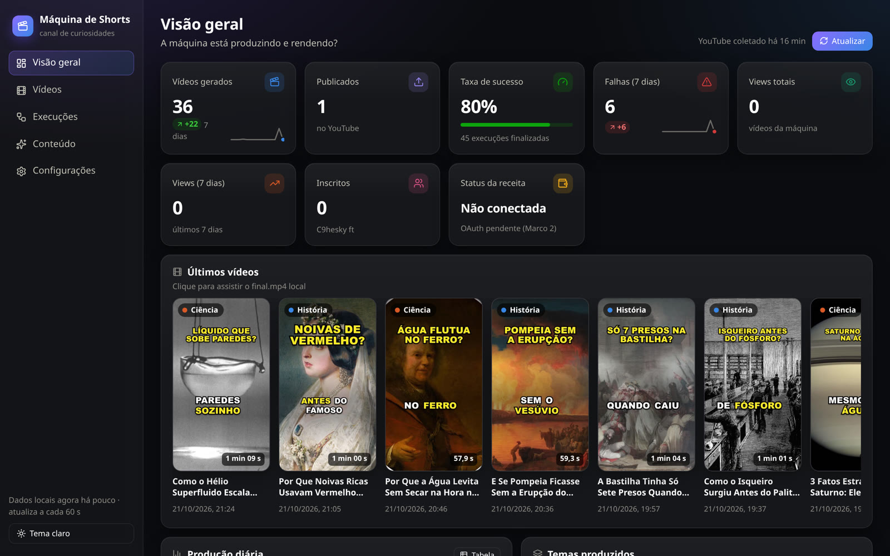
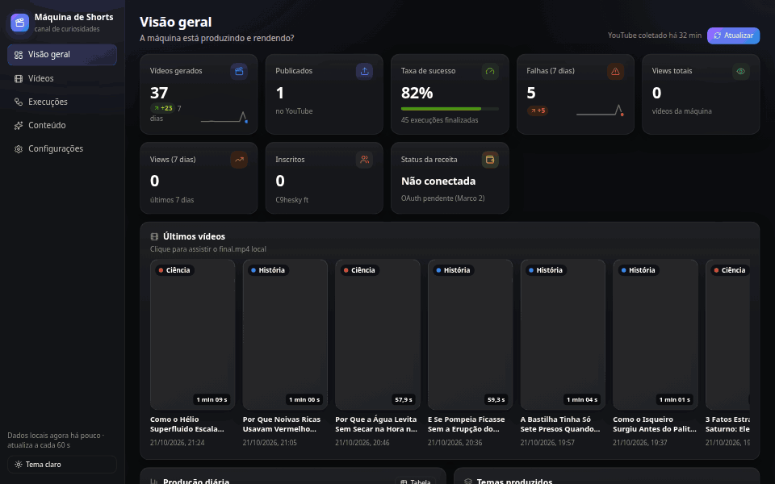
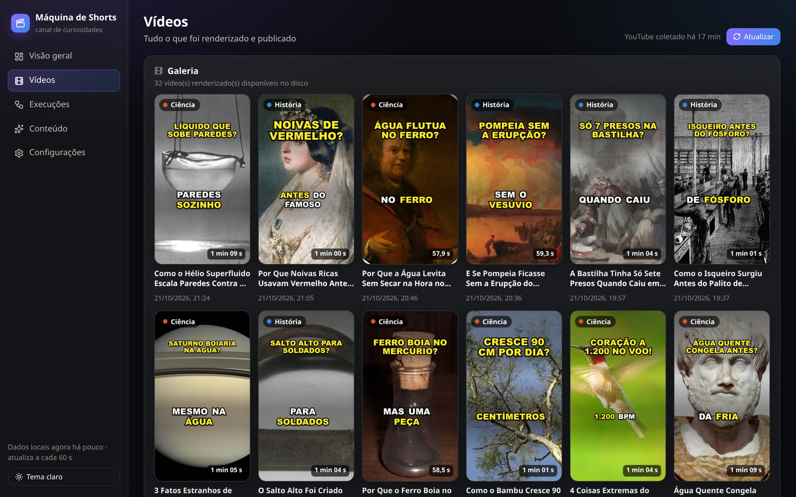
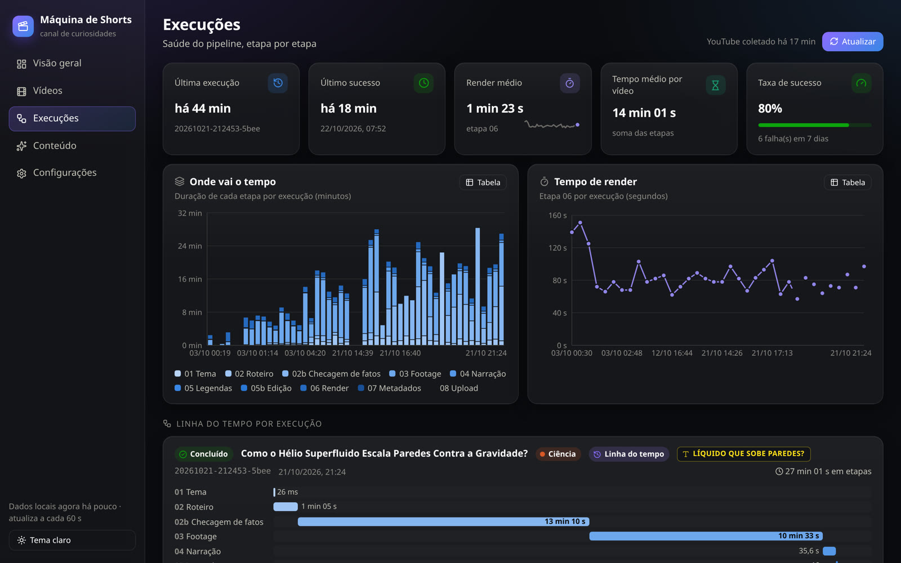
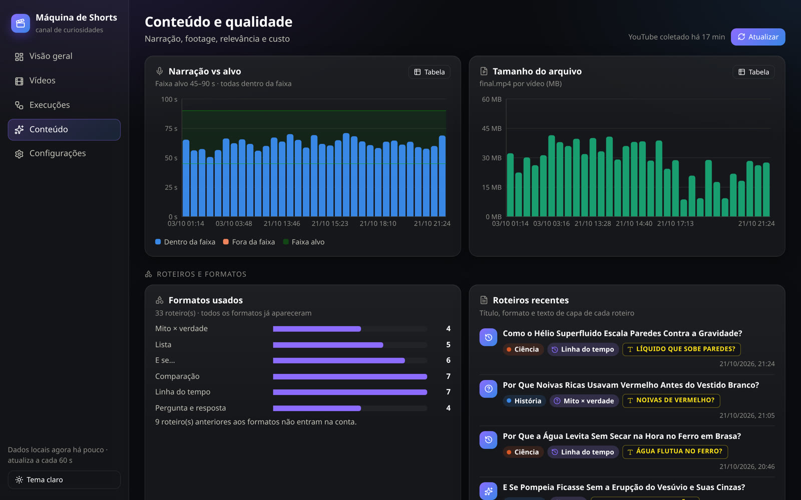
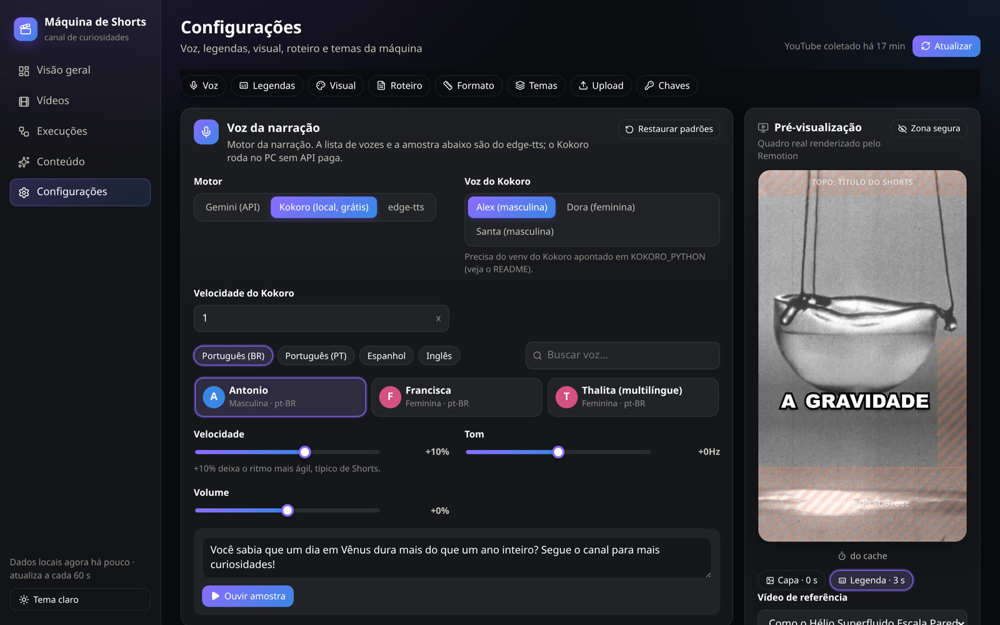
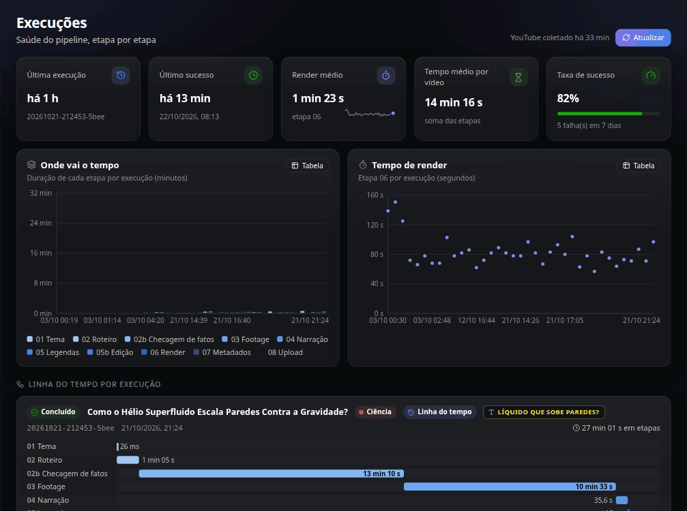
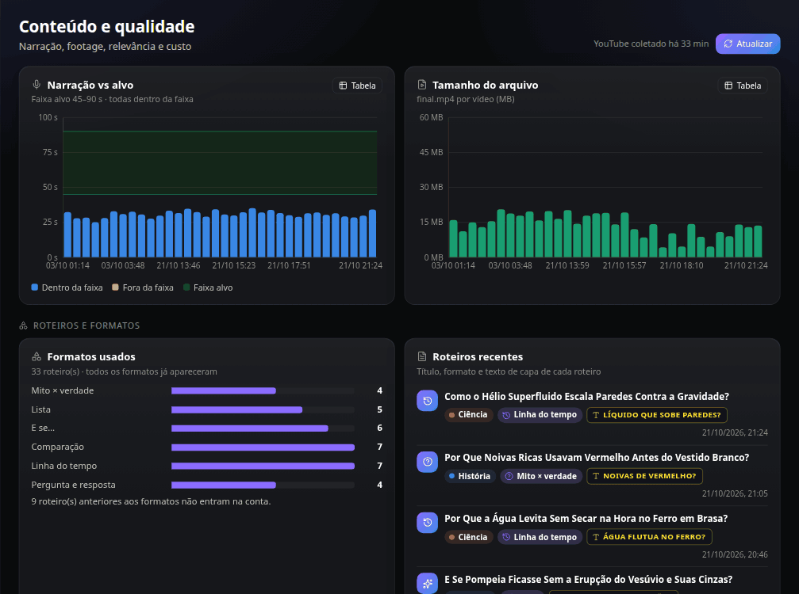

<div align="center">



<br/>
<br/>

# 🎬 Máquina de Shorts

**Um pipeline que escolhe o tema, escreve, confere os fatos, ilustra, narra, monta e publica Shorts de curiosidades. Sem revisão humana.**



<br/>

       

</div>

<details>
<summary><b>🇺🇸 English summary</b> (click to expand)</summary>

<br/>

An unattended pipeline that writes, fact-checks, illustrates, narrates, renders and publishes Brazilian-Portuguese curiosity Shorts with no human review. Node/TypeScript orchestrates resumable stages (topic → script → grounded fact-check → licensed footage scored by a vision model → TTS with word-level alignment → captions → Remotion render → metadata → YouTube/Instagram publishers), with a React dashboard on top. Highlights:

- **Zero API cost:** every LLM call goes through the Antigravity CLI agent on the owner's subscription, sandboxed (temp dir, no secrets in env, never auto-approved tools), with per-stage model routing, batched and concurrent image scoring (from ~64 s to ~8 s per clip in production runs) and an optional persistent stream-json session that skips the agent's per-call boot. Voice runs locally with Kokoro.
- **Safety gates instead of a human:** grounded fact-check with sources, ≥60 % scenes with an approved image, license filter with CC BY credits, content hashes binding approvals to content, anti-duplicate journal, daily cap, file locks.
- **Per-phrase visuals:** the script splits each scene into "beats"; images are searched, judged and cut at the exact word being spoken, zoom only on faces, no repeated stills.
- **Clips from authorized channels** (yt-dlp → Whisper → model-picked moments → face-following 9:16 crop with OpenCV), a licensed **meme/SFX layer**, and a **verdict dataset** exported in LlamaFactory format to distill the image judge into a local Qwen3-VL.
- 570+ Vitest tests, Python unittest, Linux and Windows. Built by Hélio Vinícius with AI coding agents.

</details>

<br/>

<div align="center">

<table>
  <tr>
    <td align="right"><b>🚀 Começar</b></td>
    <td align="center"><a href="#-começar">🚀 Instalação</a></td>
    <td align="center"><a href="#%EF%B8%8F-configuração">⚙️ Configuração</a></td>
    <td align="center"><a href="#%EF%B8%8F-comandos-do-dia-a-dia">⌨️ Comandos</a></td>
    <td align="center"><a href="#%EF%B8%8F-painel">🖥️ Painel</a></td>
  </tr>
  <tr>
    <td align="right"><b>💡 Entender</b></td>
    <td align="center"><a href="#-a-promessa">💥 A promessa</a></td>
    <td align="center"><a href="#-por-quê">🤔 Por quê</a></td>
    <td align="center"><a href="#-como-funciona">🧠 Como funciona</a></td>
    <td align="center"><a href="#%EF%B8%8F-travas">🛡️ Travas</a></td>
  </tr>
  <tr>
    <td align="right"><b>⚙️ Recursos</b></td>
    <td align="center"><a href="#-publicação">📣 Publicação</a></td>
    <td align="center"><a href="#%EF%B8%8F-cortes">✂️ Cortes</a></td>
    <td align="center"><a href="#-memes">😂 Memes</a></td>
    <td align="center"><a href="#-dataset-de-vereditos">🧬 Dataset</a></td>
  </tr>
  <tr>
    <td align="right"><b>👀 Ver</b></td>
    <td align="center"><a href="#-em-ação">🎬 Em ação</a></td>
    <td align="center"><a href="#-estado-atual">📍 Estado atual</a></td>
    <td align="center"><a href="#-testes">🧪 Testes</a></td>
    <td align="center"><a href="#-solução-de-problemas">🩺 Problemas</a></td>
  </tr>
  <tr>
    <td align="right"><b>📦 Projeto</b></td>
    <td align="center"><a href="#%EF%B8%8F-stack">🛠️ Stack</a></td>
    <td align="center"><a href="#%EF%B8%8F-estrutura">🗂️ Estrutura</a></td>
    <td align="center"><a href="#%EF%B8%8F-roteiro">🗺️ Roteiro</a></td>
    <td align="center"><a href="#-créditos">🙏 Créditos</a></td>
  </tr>
</table>

</div>

## 💥 A promessa

A Máquina de Shorts faz vídeos curtos (Shorts) de **curiosidades** em português do Brasil: história, ciência e espaço. Ela faz tudo sozinha: escolhe o tema, escreve o roteiro, confere os fatos, busca imagens com licença livre, grava a narração, monta o vídeo com legendas e, se o dono ligar, publica no YouTube e no Instagram. **Ninguém revisa o vídeo antes de ele sair.** Por isso o projeto tem várias travas de segurança e qualidade (veja [Travas](#%EF%B8%8F-travas)).



A meta é **custo zero de API**. Em produção, a inteligência artificial roda pelo **Antigravity CLI (`agy`)**, usando os créditos do plano do dono, sem chave de API paga. A voz roda no próprio PC com o **Kokoro**. A API paga do Gemini continua funcionando como alternativa, mas não é o caminho desejado.

A produção roda no PC Windows de casa do dono (placa RTX 3050), disparada pelo Agendador de Tarefas. O Linux serve para desenvolvimento. Há também um painel local para acompanhar tudo e mudar as configurações sem editar arquivos.

## 🤔 Por quê

Sem ninguém no meio, cada decisão de projeto responde a um risco concreto:

| Risco | Como a máquina responde |
|---|---|
| Um fato errado ir ao ar | Checagem de fatos com busca na web e fontes. Premissa falsa ou afirmação sem respaldo reprova o roteiro. |
| Imagem que não combina com a fala | Uma busca por trecho da fala (*beat*) e nota do avaliador para cada candidato contra aquela frase |
| Usar imagem sem direito de uso | Filtro de licença antes do download e créditos CC BY na descrição |
| Gastar com API a cada vídeo | `agy` nos créditos do plano e voz Kokoro no PC. Sem chave de API paga. |
| Uma execução cair no meio | Tudo salvo em `context.json` depois de cada estágio; `--resume` retoma de onde parou |
| Publicar duas vezes ou demais | Diário anti-duplicata, trava de arquivo e limite diário |

## 🎬 Em ação

<div align="center">



<br/>

<sub>Tour gravado no painel do PC de produção em 22/10/2026. A seção de chaves da aba Configurações foi omitida.</sub>

</div>

| Vídeos | Execuções |
|---|---|
|  |  |
| **Conteúdo** | **Configurações** |
|  |  |

*Prints do painel do PC de produção em 22/10/2026, abertos pelo Tailscale.*

## 📍 Estado atual

Em 22/10/2026:

| Parte | Estado |
|---|---|
| Vídeo de curiosidades (estágios 01 a 07) | ✅ Pronto |
| IA pelo Antigravity CLI (`agy`) | ✅ Pronto; é o motor de produção |
| Voz local Kokoro | ✅ Pronta; é o padrão do código (`voice.engine: kokoro`) |
| Publicação no YouTube | ⏸️ Pronta, **desligada pelo dono** (`upload.enabled: false`) |
| Publicação no Instagram Reels | ⏸️ Pronta, **desligada**; falta configurar o app na Meta |
| TikTok | ⏳ Pendente (a API direta só publica como privado) |
| Agendador do Windows | ⏸️ Scripts prontos; tarefa **removida** pelo dono (pausado) |
| Memes e efeitos (Onda 2) | ⏸️ Pronto, **desligado** por padrão |
| Cortes de canais autorizados (Onda 4) | 🟡 Pronto para gerar cortes; ainda não publica (o estágio 07 não trata cortes) |
| Painel local + acesso pelo Tailscale | 🟡 Pronto; no PC de casa falta habilitar Serve/HTTPS na conta do Tailscale |

## 🧠 Como funciona


Cada execução ganha um código (`runId`) e uma pasta `render_output/<runId>/`. Depois de cada estágio, tudo o que foi feito é salvo em `render_output/<runId>/context.json`. Assim uma execução que parou no meio pode ser retomada de onde parou. O log fica em `logs/<runId>.log` e o vídeo final em `render_output/<runId>/final.mp4`.

| Estágio | O que faz | IA usada | Onde roda |
|---|---|---|---|
| `01-pickTopic` | Sorteia categoria, ideia e formato em `config/topics.seed.json`, sem repetir a última categoria | nenhuma | local |
| `02-generateScript` | Escreve o roteiro: gancho, cenas, final e, para cada trecho da fala (*beat*), uma busca de imagem | `agy` (`llm.models.script`) | nuvem, créditos do plano |
| `02b-factCheck` | Confere cada afirmação com busca na web, reescreve o que estiver errado e confere de novo | `agy` com busca (`llm.models.factCheck`) | nuvem, créditos do plano |
| `03-fetchFootage` | Busca vídeos e imagens com licença livre (NASA, Wikimedia Commons, Pexels, Pixabay) e dá nota a cada candidato contra a fala | `agy` vendo as imagens (`llm.models.relevance`) | busca na internet + nuvem |
| `04-synthesizeVoice` | Grava a narração, encurta pausas longas e marca o tempo de cada palavra | Kokoro ou Gemini TTS; tempo das palavras com faster-whisper | Kokoro e Whisper locais; Gemini TTS na nuvem (pago) |
| `05-buildCaptions` | Agrupa as palavras em legendas e alinha cada cena com a fala | nenhuma | local |
| `05b-planEdits` | (desligado) Escolhe onde entram figurinhas e sons curtos | `agy` (modelo padrão) | nuvem |
| `06-renderVideo` | Monta o vídeo com Remotion: legenda com a palavra falada em destaque, movimento das imagens | nenhuma | local |
| `07-generateMetadata` | Título, descrição com créditos das imagens e tags, dentro dos limites do YouTube | `agy` (`llm.models.metadata`) | nuvem, créditos do plano |
| `08-uploadYouTube` | Publica em cada plataforma ligada (YouTube e depois Instagram) e registra em `data/history.json` | nenhuma | APIs do YouTube e da Meta |

Detalhes que valem saber:

- **Uma imagem por trecho da fala.** O roteiro divide cada cena em trechos (*beats*), e cada trecho tem a sua busca. Assim a imagem combina com a palavra dita naquele momento.
- **Zoom só em rosto.** Com `visual.zoomOnlyOnFaces: true` (padrão), só há zoom quando o assunto principal é um rosto. Imagem sem rosto fica parada. Nenhuma imagem se repete no mesmo vídeo.
- **Novas tentativas de tema.** Se o roteiro for reprovado na checagem de fatos, se faltarem imagens boas ou se a narração sair fora da duração, a máquina troca de tema e tenta de novo (até `pipeline.maxScriptAttempts`, padrão 2 tentativas extras). Se nada passar, sai com código `3` e não produz vídeo.

O painel mede cada estágio de cada execução:

<div align="center">



</div>

### Fluxo dos cortes (Onda 4)

Uma vertente separada, rodada por `npm run cuts`: pega vídeos longos dos canais que o dono ligou e devolve trechos verticais prontos. Veja [Cortes](#%EF%B8%8F-cortes).

1. Confere se o canal está ligado e fora da lista de bloqueio em `config/cuts.json`.
2. Descobre vídeos novos pelo RSS do canal (ou recebe um vídeo específico).
3. Baixa o vídeo com `yt-dlp`, sem login.
4. Transcreve no PC com faster-whisper.
5. O `agy` escolhe os melhores trechos: uma história completa de 45 a 90 s em canal de vlog, de 30 a 60 s em podcast.
6. Uma segunda chamada confere cada trecho com 2 min de conversa antes e depois: se o corte muda o sentido, ou o título mente ou desmoraliza alguém, o trecho é descartado.
7. Tira as pausas mortas (as risadas ficam) e recorta em vertical. Um detector de quem fala (Light-ASD, voz + boca) guia a câmera: fecha no rosto de quem fala, abre quando ninguém fala ou quando duas pessoas falam juntas. Legenda pequena em Montserrat, palavrão censurado ("merd4") e a sua marca d'água. Nos canais com a **camada de humor** ligada (padrão: vlog sim, podcast não), o agy planeja piadas entre asteriscos ("\*risos stage 3\*"), emojis de reação (Noto Emoji 3D, Apache-2.0) e até 3 efeitos (zoom rápido, preto e branco com mira, flash com palavra) nos momentos de risada; ria da situação, nunca da pessoa.
8. Salva cada corte em `render_output/<runId>/` (`final.mp4` + `context.json`). **Não publica.**

## 🛡️ Travas

Estas travas são inegociáveis. Se alguma atrapalhar, o certo é explicar ao dono, nunca contornar.

| Trava | O que garante |
|---|---|
| 🔎 Checagem de fatos | Até 3 rodadas com busca na web. Premissa falsa ou afirmação sem respaldo reprova o roteiro. Checagem sem fontes também reprova. |
| 🖼️ Trava de qualidade | Pelo menos 60% das cenas precisam de uma imagem aprovada pelo avaliador (`footage.minPassingSceneRatio`). Senão, não renderiza. |
| 📜 Filtro de licença | Só domínio público, CC0 e CC BY (Wikimedia), licenças próprias de Pexels e Pixabay, e NASA só quando o crédito é da NASA. Archive.org e licenças incertas ficam de fora. |
| ✍️ Créditos CC BY | Autor, link e "(recortado e editado)" vão na descrição. Se não couberem, o tema é trocado. |
| 🔗 Hashes de conteúdo | As aprovações ficam presas ao conteúdo exato. Se o roteiro ou o vídeo mudar depois, a aprovação deixa de valer. |
| 📒 Diário anti-duplicata | Um diário por plataforma na pasta da execução (`upload.<plataforma>.journal.json`). Uma nova tentativa retoma o envio, nunca publica duas vezes. |
| 📅 Limite diário | `upload.maxUploadsPerDay` (YouTube) e `instagram.maxPostsPerDay` contam as últimas 24 h. |
| 🔒 Trava de arquivo | Dois processos nunca publicam ao mesmo tempo. Se `data/history.json` estiver ilegível, a publicação para. |
| 🔁 Sem repetir assunto | O roteiro recebe os ~30 assuntos mais recentes e é rejeitado se repetir um deles. |
| ⏸️ Publicação desligada | Nada sai com `upload.enabled: false` (padrão). Só o dono liga. |
| 🗝️ Segredos | Chaves e tokens são mascarados nos logs. Cada processo filho (Python, ffmpeg, `agy`) recebe só as variáveis de que precisa. |
| 📦 `agy` isolado | Sempre com `--sandbox`, numa pasta temporária só com as imagens da chamada e sem nenhuma chave no ambiente. **Nunca** com `--dangerously-skip-permissions`. |
| ✋ Autorização dos cortes | Canal sem link público de autorização não é cortado. Não existe opção para desligar essa trava. |

## 🚀 Começar

### Windows (produção)

Precisa de: Windows 10/11, Git, Node.js 22 ou mais novo (o pipeline aceita 20, o painel exige 22) e Python 3.11 ou mais novo (o projeto usa 3.13). O ffmpeg não precisa ser instalado: o Remotion já traz o dele.

1. Instale as dependências do Node:
   ```powershell
   npm install
   npm --prefix dashboard install
   npx remotion browser ensure          # baixa o Chrome que o Remotion usa no render
   ```
2. Crie o ambiente Python do projeto e baixe o modelo Whisper (~140 MB, marca o tempo de cada palavra):
   ```powershell
   python -m venv .venv
   .venv\Scripts\python.exe -m pip install -r python/requirements.txt
   .venv\Scripts\python.exe python/tts/align_narration.py --download-only
   ```
3. Baixe a parte usada do OpenMontage (busca de imagens), fixada num commit conhecido:
   ```powershell
   powershell -ExecutionPolicy Bypass -File scripts/setup_vendor.ps1
   ```
4. Instale o **Antigravity CLI** e faça o login uma vez no próprio `agy`. O login fica salvo e as execuções seguintes não pedem nada. Confira os modelos disponíveis com `agy models`.
5. Instale o **Kokoro** num ambiente Python separado, fora do projeto (ele depende do torch, que é pesado):
   ```powershell
   uv venv --python 3.12 "$env:LOCALAPPDATA\maquina-tts\kokoro"
   uv pip install --python "$env:LOCALAPPDATA\maquina-tts\kokoro\Scripts\python.exe" --index-url https://download.pytorch.org/whl/cu124 --extra-index-url https://pypi.org/simple --index-strategy unsafe-best-match torch
   uv pip install --python "$env:LOCALAPPDATA\maquina-tts\kokoro\Scripts\python.exe" kokoro soundfile
   ```
   Depois aponte `KOKORO_PYTHON` para o caminho completo desse `python.exe` (ex.: `C:\Users\<você>\AppData\Local\maquina-tts\kokoro\Scripts\python.exe`) no `.env`. Na RTX 3050 com driver recente, `cu124` ou `cu130` funcionam (o PC de casa usa `cu130`). Sem placa NVIDIA, troque por `cpu`. A primeira narração baixa os pesos do Hugging Face; as seguintes usam o cache, sem internet.
6. Copie o modelo de configuração e preencha:
   ```powershell
   copy .env.example .env
   ```
7. Só para os cortes: o ambiente `.venv-cuts` com OpenCV e `yt-dlp` (veja [Cortes](#%EF%B8%8F-cortes)).
8. Teste sem publicar: `npm run pipeline -- --until 06-renderVideo`.

<details>
<summary><b>🐧 Linux (desenvolvimento)</b></summary>

<br/>

O mesmo projeto roda no Linux. O agendador (`scheduler/`) é só do Windows.

```bash
npm install && npm --prefix dashboard install && npx remotion browser ensure
python3 -m venv .venv
.venv/bin/python -m pip install -r python/requirements.txt
.venv/bin/python python/tts/align_narration.py --download-only
cp .env.example .env
```

O `setup_vendor.ps1` é PowerShell. Sem o `pwsh`, rode os mesmos passos dele com o git (mesmo commit fixado no script):

```bash
git clone --depth 1 --filter=blob:none --no-checkout https://github.com/calesthio/OpenMontage.git vendor/openmontage
git -C vendor/openmontage sparse-checkout set --no-cone /tools/ /lib/
git -C vendor/openmontage fetch --depth 1 --filter=blob:none origin 08e2151fa02de28a5d6a312b3d575692bf147ad7
git -C vendor/openmontage -c advice.detachedHead=false checkout --force 08e2151fa02de28a5d6a312b3d575692bf147ad7
```

Kokoro no Linux sem placa de vídeo: acrescente `--index-url https://download.pytorch.org/whl/cpu` ao `uv pip install` e use `KOKORO_PYTHON=<pasta>/bin/python`. Ele precisa do `espeak-ng` da distribuição (veja [Solução de problemas](#-solução-de-problemas)). O ffmpeg vem do Remotion da plataforma; se faltar, o do PATH é usado.

</details>

### ⌨️ Comandos do dia a dia

```bash
npm run pipeline                                   # gera um vídeo (e publica, se a publicação estiver ligada)
npm run pipeline -- --until 06-renderVideo         # gera sem publicar
npm run pipeline -- --resume <runId>               # retoma uma execução, pulando o que já está pronto
npm run pipeline -- --fixture test/fixtures/context.script-only.json   # usa um roteiro pronto, sem IA
npm run stage -- 06-renderVideo --run <runId>      # refaz um estágio (aceita "06" ou "renderVideo")
npm run stage -- 08-uploadYouTube --run <runId>    # publica um vídeo já pronto (ex.: depois do limite diário)
npm run dashboard                                  # painel em http://localhost:5180
npm run memes -- list                              # biblioteca de memes (veja a seção Memes)
npm run cuts -- --scan                             # cortes dos canais autorizados, sem publicar
npx tsx scripts/export_verdicts_dataset.ts         # monta o dataset do juiz de imagem local
npx tsx scripts/test_agy_relevance.ts              # benchmark: agy x API do Gemini nas mesmas imagens
npm run auth:youtube                               # login do YouTube (uma vez)
npm run auth:instagram                             # login do Instagram (uma vez)
```

> [!IMPORTANT]
> Antes de rodar `npm run pipeline` à mão, confira `LLM_PROVIDER` no `.env`: quem atualizou de uma versão antiga pode ainda estar com `gemini` (API paga), mesmo com o novo padrão `antigravity-cli`.

**Códigos de saída do pipeline:** `0` deu certo, `1` erro, `3` nenhum vídeo publicável (trava de qualidade ou de fatos; não é falha da máquina). Uma execução rejeitada não pode ser retomada com `--resume`: comece outra.

O benchmark `test_agy_relevance.ts` chama a **API paga do Gemini** (precisa de `GEMINI_API_KEY`) e grava o resultado em `data/agy_benchmark_results.json`. Só rode se o dono aprovar o gasto.

### ⏰ Agendamento (Windows)

Os scripts ficam em `scheduler/` e rodam no PowerShell que já vem no Windows. Nada é registrado sozinho, e **só o dono decide registrar a tarefa**.

| Script | O que faz |
|---|---|
| `run_once.ps1` | Uma execução sem ninguém olhando: impede execução dupla, encerra após 60 min, log em `logs/scheduler/<data>.log`, alerta em `data/alerts.jsonl` e notificação do Windows quando falha |
| `register_task.ps1` | Cria a tarefa "Maquina de Shorts" (padrão 09:00 e 18:00, atraso aleatório de até 20 min). `-DryRun` só mostra. |
| `unregister_task.ps1` | Remove a tarefa (mantém logs e alertas) |
| `status.ps1` | Estado da tarefa, última e próxima execução, últimos alertas |

```powershell
powershell -NoProfile -ExecutionPolicy Bypass -File scheduler\register_task.ps1 -DryRun
powershell -NoProfile -ExecutionPolicy Bypass -File scheduler\register_task.ps1 -Times 11:45,18:45
powershell -NoProfile -ExecutionPolicy Bypass -File scheduler\status.ps1
powershell -NoProfile -ExecutionPolicy Bypass -File scheduler\unregister_task.ps1
```

A auditoria sugeriu 11:45 e 18:45 para o público brasileiro. Por padrão a tarefa só roda com o dono logado (`-LogonType Interactive`); `S4U` e `Password` rodam deslogado (registrar como administrador). O `run_once.ps1` devolve `0`, `1`, `3` como o pipeline e `124` quando estoura o tempo. Para testar sem o pipeline real: `$env:MAQUINA_SCHEDULER_TEST='fail'` (ou `ok`, `quality`, `hang`).

## ⚙️ Configuração

Duas fontes: o `.env` (chaves e caminhos, fora do git) e o `config/pipeline.config.json` (como o vídeo é feito, versionado e editável pelo painel).

Exemplo de produção com custo zero (os números são exemplos):

```ini
LLM_PROVIDER=antigravity-cli
ANTIGRAVITY_FALLBACK=none
ANTIGRAVITY_CLI_CONCURRENCY=4
ANTIGRAVITY_CLI_TIMEOUT_S=240
ANTIGRAVITY_CLI_SESSION_TURNS=6
KOKORO_PYTHON=C:\Users\<você>\AppData\Local\maquina-tts\kokoro\Scripts\python.exe
```

> [!WARNING]
> **Atenção aos modelos Claude e GPT dentro do `agy`.** Eles gastam um saldo separado de "AI credits", que acabou no teste ("AI credits balance is too low"). Não use esses modelos em produção até o dono confirmar. Fique nos modelos Gemini.

<details>
<summary><b>🔑 <code>.env</code>: todas as variáveis (chaves e caminhos)</b></summary>

<br/>

O `.env` nunca entra no git. O modelo comentado é o `.env.example`. A tabela abaixo não traz valores reais.

| Grupo | Variável | Para quê |
|---|---|---|
| IA | `LLM_PROVIDER` | `antigravity-cli` (produção), `gemini` (API paga) ou `anthropic`. Sem valor, o código usa `antigravity-cli` (custo zero). |
| IA | `ANTIGRAVITY_CLI_PATH` | Onde está o `agy` (padrão: `agy` no PATH) |
| IA | `ANTIGRAVITY_MODEL` | Modelo padrão do `agy` (vazio = `gemini-3.8-flash-medium`). `llm.models` tem prioridade por etapa. |
| IA | `ANTIGRAVITY_CLI_TIMEOUT_S`, `LLM_TIMEOUT_RETRIES` | Tempo máximo por chamada (padrão 240 s). Estourou? Tenta de novo até `LLM_TIMEOUT_RETRIES` vezes (padrão 2) antes de falhar. |
| IA | `ANTIGRAVITY_CLI_CONCURRENCY` | Quantos `agy` ao mesmo tempo (padrão 2) |
| IA | `ANTIGRAVITY_CLI_SESSION_TURNS` | Sessão contínua: quantas perguntas cada processo `agy` responde antes de reiniciar (padrão 0 = desligado). Economiza as instruções internas do agy a cada pergunta. |
| IA | `ANTIGRAVITY_FALLBACK` | Se o `agy` falhar: `none` (padrão, custo zero) ou `gemini` (usa a API paga) |
| IA | `GEMINI_API_KEY`, `GEMINI_MODEL` | Só com `LLM_PROVIDER=gemini`, voz Gemini TTS ou `ANTIGRAVITY_FALLBACK=gemini` |
| IA | `ANTHROPIC_API_KEY`, `ANTHROPIC_MODEL` | Só com `LLM_PROVIDER=anthropic` |
| Voz | `KOKORO_PYTHON` | Python do ambiente do Kokoro (vazio = `.venv` do projeto) |
| Imagens | `PEXELS_API_KEY`, `PIXABAY_API_KEY` | Mais fontes de imagem e vídeo (recomendado). A do Pixabay também serve aos memes. |
| Publicação | `YT_CLIENT_SECRET_PATH`, `YT_TOKEN_PATH` | Arquivos do login do YouTube (padrão em `secrets/`) |
| Publicação | `YOUTUBE_CHANNEL_ID` | ID do canal (`UC...`), mostrado pelo `npm run auth:youtube` |
| Publicação | `INSTAGRAM_APP_ID`, `INSTAGRAM_APP_SECRET` | App da Meta, usados só pelo `npm run auth:instagram` |
| Painel | `YOUTUBE_API_KEY` | Estatísticas públicas no painel (não serve para publicar) |
| Painel | `DASHBOARD_ALLOWED_HOSTS` | Nomes extras aceitos além de `localhost`, separados por vírgula (ex.: o nome do PC no Tailscale) |
| Painel | `DASHBOARD_PORT` | Porta do painel (padrão 5180) |
| Painel | `DASHBOARD_LLM_PRICE_INPUT_USD_PER_MTOK`, `DASHBOARD_LLM_PRICE_OUTPUT_USD_PER_MTOK` | Preço de referência para a estimativa de custo do painel |
| Cortes | `CUTS_PYTHON` | Python do ambiente com OpenCV (vazio = `.venv-cuts/`) |
| Cortes | `CUTS_WHISPER_MODEL`, `CUTS_WHISPER_DEVICE` | Modelo e dispositivo do Whisper na transcrição (padrão `base` / `cpu`; com placa: `small` / `cuda`) |
| Cortes | `CUTS_FONT` | Fonte TTF das legendas dos cortes |
| Diagnóstico | `LOG_LEVEL=debug` | Mostra também as mensagens de depuração no terminal |

</details>

<details>
<summary><b>🎛️ <code>config/pipeline.config.json</code>: como o vídeo é feito</b></summary>

<br/>

Este arquivo é versionado. Quase tudo dá para mudar na aba **Configurações** do painel, que guarda um backup em `config/backups/` a cada gravação. Os padrões estão em `src/shared/settings.ts` e o formato é validado em `src/orchestrator/lib/config.ts`. As mudanças valem a partir da próxima execução.

| Opção | Padrão | O que faz |
|---|---|---|
| `video.minSeconds` / `maxSeconds` | 45 / 90 | Duração aceita da narração. Fora disso, troca de tema. |
| `voice.engine` | `kokoro` | `kokoro` (local, grátis, recomendado), `gemini` (API paga) ou `edge-tts` (legado, fora do ar). Sem o Kokoro instalado, o estágio 04 falha com aviso; não cai na API paga. |
| `voice.kokoroVoice` / `kokoroSpeed` | `pm_alex` / 1 | Vozes pt-BR: `pm_alex` (Alex), `pf_dora` (Dora), `pm_santa` (Santa); velocidade de 0,5 a 2 |
| `voice.geminiVoice` / `geminiModel` / `style` | `Fenrir` / `gemini-3.8-flash-tts` / texto | Só para a voz Gemini |
| `voice.maxPauseMs` | 250 | Maior pausa mantida na narração, em ms |
| `llm.models.script` / `factCheck` / `relevance` / `metadata` | vazio | Modelo do `agy` por etapa, para dividir o gasto entre as cotas do plano. Vazio = `ANTIGRAVITY_MODEL`. |
| `footage.relevance.batchSize` | 1 | Quantas imagens da mesma cena vão numa só chamada (até 6). Vale aumentar com o `agy`, que demora em cada chamada. |
| `footage.relevance.minScore` | 6 | Nota mínima (0 a 10) para uma imagem ser aprovada |
| `footage.minPassingSceneRatio` | 0.6 | Parte das cenas que precisa de imagem aprovada |
| `script.minWords` / `maxWords` | 160 / 195 | Tamanho do roteiro |
| `script.factCheck` | `true` | Checagem de fatos. Desligar não é recomendado e exige `upload.allowWithoutFactCheck: true` para publicar. |
| `script.formats` | todos | Formatos sorteados: `mito-verdade`, `lista`, `e-se`, `comparacao`, `linha-do-tempo`, `pergunta-resposta` |
| `visual.zoomOnlyOnFaces` | `true` | Zoom só quando o assunto é um rosto |
| `visual.maxShotSeconds` | 4.5 | Maior tempo de um vídeo antes de cortar para outra parte dele |
| `captions.*` | — | Fonte, cores, palavras por legenda, posição, destaque |
| `editing.enabled` | `false` | Memes e efeitos (estágio 05b) |
| `upload.enabled` | `false` | Publicação no YouTube. **Só o dono liga.** |
| `upload.privacyStatus` / `maxUploadsPerDay` | `public` / 3 (no arquivo atual) | Privacidade e limite em 24 h |
| `instagram.enabled` / `maxPostsPerDay` | `false` / 3 | Publicação no Instagram. **Só o dono liga.** |
| `pipeline.maxScriptAttempts` | 2 | Tentativas extras com outro tema |
| `storage.keepFailedRunsDays` | 3 | Execuções rejeitadas são apagadas depois disso |
| `storage.keepUploadedVideosDays` | 14 | Execuções publicadas perdem o `final.mp4` e as imagens, mas mantêm `context.json`, log e vereditos |

Exemplo de modelos por etapa (confira os nomes com `agy models`):

```json
"llm": { "models": { "script": "gemini-4-argon-medium", "factCheck": "gemini-3.8-flash-medium", "relevance": "gemini-3.8-flash-low", "metadata": "gemini-4-argon-low" } }
```

Os temas ficam em `config/topics.seed.json` (também editáveis na aba Configurações → Temas).

</details>

## 🖥️ Painel

`npm run dashboard` abre o painel em http://localhost:5180. Ele só escuta no próprio PC (`127.0.0.1`). As chaves ficam no servidor e nunca vão para o navegador.

| Aba | O que mostra |
|---|---|
| 📊 **Visão geral** | Vídeos feitos e publicados, taxa de sucesso, views, inscritos e galeria com player |
| 🎞️ **Vídeos** e ⏱️ **Execuções** | Cada vídeo, cada estágio, quanto tempo levou e onde falhou |
| ✨ **Conteúdo** | Duração da narração, fontes e licenças das imagens, notas do avaliador, uso de tokens e custo estimado |
| ⚙️ **Configurações** | Voz, legendas, visual, roteiro, formato, marca d'água (texto e logo PNG, em Shorts e cortes), temas, canais de corte, upload, edição (memes) e o estado das chaves, com prévia de um quadro real do vídeo |

<div align="center">



</div>

**Acesso de outro aparelho (celular, trabalho):** use o [Tailscale](https://tailscale.com), uma rede privada entre os seus aparelhos.

1. Instale o Tailscale no PC e no outro aparelho, com a mesma conta.
2. No PC, rode `tailscale serve --bg 5180`.
3. Coloque o nome do PC na rede (ex.: `pc-casa.tail1234.ts.net`) em `DASHBOARD_ALLOWED_HOSTS` no `.env` e reinicie o painel.

> [!CAUTION]
> **Nunca use um túnel público.** O painel não tem login, e a tela Configurações grava arquivos.

## 📣 Publicação

Regras que valem para todas as redes:

- **Só o dono liga a publicação.** Nenhum agente publica, nem como teste, sem a confirmação dele na conversa.
- Use **uma conta dedicada à máquina**, nunca a conta pessoal.
- Se uma rede falhar, as outras seguem.

| Rede | Estado | O que falta |
|---|---|---|
| ▶️ YouTube | Pronto e autorizado (canal "C9hesky ft"). Desligado pelo dono. | Ligar `upload.enabled` e registrar o agendador |
| 📸 Instagram Reels | Pronto e desligado | Conta profissional, app na Meta, `npm run auth:instagram` |
| 🎵 TikTok | Não implementado | Decisão do dono (ver `planejamento/marco-4-tiktok-instagram.md`) |

<details>
<summary><b>▶️ YouTube: login e envio</b></summary>

<br/>

`npm run auth:youtube` abre o login do Google. Como o app não é verificado, aparece "O Google não verificou este app": clique em **Avançado** e depois em **Acessar Máquina de Shorts**. O terminal mostra o ID do canal; coloque-o em `YOUTUBE_CHANNEL_ID`. O token fica em `secrets/youtube.token.json` e se renova sozinho. Depois do envio, a máquina confere a privacidade que o YouTube realmente aplicou e avisa no log se ele travou o vídeo como privado. A narração sintética sobre imagens reais não precisa ser declarada, então `upload.containsSyntheticMedia` fica `false`.

</details>

<details>
<summary><b>📸 Instagram Reels: passo a passo, uma vez só</b></summary>

<br/>

Usa a "API do Instagram com login do Instagram" (sem página do Facebook).

1. No app do Instagram, mude a conta para **profissional** (Criador ou Empresa).
2. Em [developers.facebook.com/apps](https://developers.facebook.com/apps), crie um app do tipo **Empresa** com o caso de uso "Gerenciar mensagens e conteúdo no Instagram".
3. Em Funções do app → **Testadores do Instagram**, adicione a conta e aceite o convite no Instagram. Assim não precisa de revisão da Meta.
4. Nas configurações do login comercial, cadastre a URI de redirecionamento `https://mystic0112.github.io/Maquina-de-Shorts/oauth/callback.html` (a página está em `docs/oauth/callback.html`).
5. Coloque o App ID e o App Secret em `INSTAGRAM_APP_ID` e `INSTAGRAM_APP_SECRET`.
6. Rode `npm run auth:instagram`. Se o navegador bloquear o retorno, a página mostra um código para colar no terminal.
7. Ligue no `config/pipeline.config.json`: `"instagram": { "enabled": true, "maxPostsPerDay": 3 }` (a aba Configurações ainda não tem esta seção).

Para enviar o vídeo, a máquina abre por poucos minutos um **túnel temporário do `cloudflared`** (precisa estar instalado) e passa o endereço ao Instagram. Enquanto o túnel está aberto, quem souber o endereço aleatório pode baixar o vídeo; ele fecha assim que o Instagram termina de buscar. O token vale 60 dias e se renova sozinho quando faltam menos de 10. A legenda reaproveita título, gancho, hashtags e créditos; se os créditos não couberem, o Instagram é pulado naquele vídeo.

</details>

**TikTok.** Pela API direta, sem auditoria, todo post sai privado. A pesquisa sugeriu testar um intermediário (Zernio grátis ou Upload-Post pago). Nada foi implementado.

## ✂️ Cortes

Vertente separada do vídeo de curiosidades (Onda 4). Pega vídeos dos canais ligados, transcreve, escolhe trechos com o `agy` (vlog: história de 45 a 90 s; podcast: 30 a 60 s), descarta o que mudar o sentido ou tiver título que mente ou desmoraliza, tira as pausas mortas, recorta em vertical seguindo o rosto de quem fala e deixa cada corte em `render_output/<runId>/` (`final.mp4` + `context.json`), no formato que os estágios 07 e 08 leem. **O comando não publica nada.**

> [!IMPORTANT]
> **Trava dos canais.** Um canal só é cortado quando o dono o liga em `config/cuts.json` (`enabled: true`) e ele não está bloqueado (`blocked`, com o motivo). Decisão do dono (22/10/2026): cortar vídeo público pode; mudar o sentido da fala ou desmoralizar alguém, nunca. Canal que pedir para parar ou reclamar de direitos entra em `blocked` para sempre. O link `authorization.url` é opcional, só como prova. Canal recusado sai com código `3`. O jeito mais fácil de cuidar dos canais é o painel, em **Configurações > Canais de corte**: cole o link do canal (ex.: `youtube.com/@acfperformance`), escolha vlog ou podcast, ligue, desligue ou bloqueie. Ele grava o `config/cuts.json` (fora do git), criado a partir do `config/cuts.example.json` no primeiro salvamento.

O que o `config/cuts.json` define: os canais (`id`, `name`, `enabled`, `blocked`, `style` = `vlog` ou `podcast`, `minSeconds`/`maxSeconds` opcionais, `authorization` opcional, `credit` que vai para a descrição, `maxVideosPerDay`), o tamanho dos cortes de podcast (`clip.minSeconds`/`maxSeconds`, padrão do exemplo 30–60 s; vlog usa 45–90 s; máximo 180 s, o limite do Shorts; `clip.perVideo`; `clip.framing`; cor e palavras por legenda) e o download (`download.maxHeight`, `download.ytDlp`).

```bash
npm run cuts -- --scan                                       # RSS dos canais autorizados, processa o que for novo
npm run cuts -- --video https://www.youtube.com/watch?v=ID   # um vídeo (--channel UC... se houver mais de um canal)
npm run cuts -- --video ID --framing open --clips 2          # "open" = janela 4:5 sobre fundo desfocado; "face" = 9:16 cheio
npm run cuts -- --video ID --source video.mp4 --transcript t.json   # desenvolvimento: sem download nem Whisper
```

Códigos de saída: `0` ok, `1` erro, `3` nada a fazer (nenhum canal ligado, nenhum vídeo novo ou nenhum trecho aprovado na conferência).

**Teste real:** um vídeo de 40 min virou 2 cortes em 2 min 41 s, no processador, sem contar o download.

<details>
<summary><b>Requisitos, o que é pulado e onde ficam os arquivos</b></summary>

<br/>

Requisitos:

- Um ambiente Python só dos cortes, `.venv-cuts`, com OpenCV e `yt-dlp`:
  ```bash
  uv venv .venv-cuts
  uv pip install --python .venv-cuts/bin/python opencv-python-headless numpy pillow yt-dlp av python_speech_features scipy   # Windows: .venv-cuts\Scripts\python.exe
  uv pip install --python .venv-cuts/bin/python --index-url https://download.pytorch.org/whl/cu130 --extra-index-url https://pypi.org/simple --index-strategy unsafe-best-match torch   # sem GPU NVIDIA: troque cu130 por cpu
  ```
  Em outra pasta, aponte `CUTS_PYTHON`. A transcrição usa o faster-whisper do `.venv` do projeto (`CUTS_WHISPER_MODEL`, `CUTS_WHISPER_DEVICE`).
- `yt-dlp` **atualizado**. O comando chama `yt-dlp` do PATH; para usar o do `.venv-cuts`, ponha o caminho em `download.ytDlp` (ex.: `.venv-cuts/bin/yt-dlp`; caminhos relativos partem da raiz do projeto). Ele baixa sem login e sem cookies; versões velhas levam erro 403 do YouTube.
- O detector de rostos YuNet (~230 KB) é baixado uma vez para `models/yunet/`.

O que é pulado: vídeos com restrição de idade ou privados (a máquina nunca faz login) e, no `--scan`, vídeos com "ao vivo" ou "live" no título.

Onde ficam as coisas: vídeo-fonte e transcrição em `data/cuts/sources/`, diário anti-duplicata em `data/cuts/processed.json`, cortes prontos em `render_output/<runId>/`.

</details>

**Limitações conhecidas:**

- Cada corte já sai com título, descrição e tags (estágio 07): um resumo fiel do trecho, `#shorts #cortes` + hashtags do assunto e, sempre, o crédito do canal com o link do vídeo completo. A publicação (08) dos cortes continua desligada até o dono decidir.
- No PC de produção os cortes rodam sozinhos com o loop: `scripts\loop.ps1 -PullBetween -CutsEveryHours 3` faz a busca (`--scan`) entre vídeos, no máximo a cada 3 h.
- A troca de quem está falando ainda fica nervosa quando a pessoa aparece de perfil.

## 😂 Memes

Figurinhas e sons curtos que reforçam a fala (surpresa, erro, vitória), da Onda 2. **Desligado por padrão** (`editing.enabled`, aba Configurações → Edição).

Quando ligado, o estágio `05b-planEdits` manda ao `agy` a narração com o tempo de cada palavra e a lista da biblioteca `assets/memes/`. As regras:

- No máximo `editing.maxCuesPerVideo` inserções (padrão 6), com pelo menos 4 s entre elas.
- Nada nos 2,5 s iniciais (o gancho) nem nos 2 s finais.
- Figurinhas ficam de 1 a 3 s na tela, acima da legenda, nas laterais ou no canto (`top`, `side-left`, `side-right`, `corner`), nunca sobre ela.
- Sons têm até 1,5 s e tocam com volume `editing.sfxVolume` (padrão 0,35).
- Memes clássicos (cenas de TV ou filme) não entram.

**Fontes e licenças aceitas:** Pixabay (Pixabay License), Freesound (CC0 ou CC BY), LottieFiles (Lottie Simple License), emojis abertos (Noto Apache-2.0, OpenMoji CC BY-SA 4.0, Twemoji CC BY 4.0) e arquivos gerados aqui (`own`). Qualquer outra licença é recusada na importação e no pipeline. Créditos CC BY e BY-SA vão para a descrição junto com os das imagens.

```bash
npm run memes -- demo                     # 3 figurinhas + 1 som de exemplo, gerados no PC
npm run memes -- add-pixabay --query "boom" --kind sticker --limit 10 --tags "explosão,surpresa"
npm run memes -- add-emoji --set openmoji --codepoints 1F62E,1F4A5 --tags "surpresa,explosão"
npm run memes -- add-file --file pop.wav --kind sfx --source freesound --url https://freesound.org/s/123/ --license "CC0" --tags "pop"
npm run memes -- list                     # inventário
npm run memes -- check                    # confere licenças e arquivos
```

Cada comando baixa no máximo 25 arquivos. A Pixabay não tem API de áudio: sons dela e do Freesound são baixados à mão e registrados com `add-file`. Animações Lottie entram no inventário, mas **ainda não aparecem no vídeo**, porque o pacote `@remotion/lottie` não está instalado. Os arquivos (`assets/memes/files/`) ficam fora do git; só o `inventory.json` é versionado.

## 🧬 Dataset de vereditos

Cada execução grava `render_output/<runId>/footage_verdicts.jsonl` com **todas** as imagens avaliadas: as aprovadas, as rejeitadas e as que deram erro, com os quadros enviados, o trecho da fala, a nota e o motivo. A limpeza automática guarda esses arquivos em `data/verdicts/`.

O objetivo é treinar um modelo de visão que rode na RTX 3050 e substitua parte das chamadas ao `agy` (o juiz de imagem local).

```bash
npx tsx scripts/export_verdicts_dataset.ts --out data/datasets/vision_judge --min-runs 1
```

O script monta o dataset no formato do LlamaFactory (ShareGPT multimodal): `train.json`, `val.json`, `dataset_info.json`, `stats.json` e as imagens. A separação 90/10 é por execução, para que imagens da mesma cena nunca caiam no treino e na validação ao mesmo tempo.

## 🧪 Testes

Tudo precisa passar antes de qualquer commit:

```bash
npx tsc -p tsconfig.json --noEmit
npx vitest run
cd dashboard && npm run typecheck
.venv\Scripts\python.exe -m unittest discover -s python/tts -p "test_*.py"     # Linux: .venv/bin/python
```

Os cortes têm testes próprios: `.venv\Scripts\python.exe -m unittest discover -s python/cuts -p "test_*.py"`.

Depois, a varredura de segredos nos arquivos preparados para o commit. Se ela acusar algo, **pare**:

```bash
git diff --cached --name-only -z | xargs -0 grep -lE 'AIza[0-9A-Za-z_-]{30,}|sk-ant-[0-9A-Za-z_-]{20,}|GOCSPX-|IGAA[0-9A-Za-z_-]{30,}|-----BEGIN [A-Z ]*PRIVATE KEY'
```

Os testes têm valores falsos de propósito (`AIzaFAKE…`, `GOCSPX-FAKE…`, `IGAAfake…`); confirme que é falso antes de seguir. Nunca commite `.env`, `secrets/`, `render_output/`, `logs/`, `data/history.json`, `models/`, vídeos ou áudios.

## 🩺 Solução de problemas

<details>
<summary><b>Sintomas conhecidos e o que fazer</b> (13 casos)</summary>

<br/>

| Sintoma | Causa e o que fazer |
|---|---|
| `yt-dlp` com erro HTTP 403 | O YouTube mudou e o `yt-dlp` ficou velho. Atualize (`yt-dlp -U`, ou pelo gerenciador onde ele foi instalado). |
| Corte: "yt-dlp needs a login for this video" | Vídeo com restrição de idade ou privado. No `--scan` ele é pulado e anotado no diário; a máquina nunca usa login. |
| Corte demora muito em "re-encoding to H.264" | O vídeo-fonte veio em AV1, que o OpenCV não lê. A conversão é automática, só é lenta. |
| `agy` com "AI credits balance is too low" | Algum modelo Claude ou GPT foi escolhido em `llm.models` ou `ANTIGRAVITY_MODEL`. Volte para os modelos Gemini. |
| "agy retornou resposta vazia (ações negadas: ...)" | O modelo tentou rodar um comando e o sandbox negou. A máquina já repete uma vez com um lembrete; se falhar de novo, retome com `--resume`. Nunca tire o `--sandbox`. |
| "agy excedeu o tempo limite" | Uma chamada lenta. Já há uma nova tentativa automática. Se repetir, aumente `ANTIGRAVITY_CLI_TIMEOUT_S`. |
| Aviso "set a HF_TOKEN to enable higher rate limits" | Aviso do Hugging Face no primeiro download do Kokoro. Inofensivo; depois os pesos vêm do cache, sem internet. |
| Painel responde "Forbidden host" | O nome usado não está liberado. Coloque-o em `DASHBOARD_ALLOWED_HOSTS` e reinicie o painel. |
| Kokoro falha no Linux por falta do espeak | Instale o `espeak-ng` da distribuição (ex.: `sudo apt install espeak-ng`) ou aponte `ESPEAK_DATA_PATH` e `PHONEMIZER_ESPEAK_LIBRARY`. |
| Painel não abre quando iniciado sem terminal | O `tsx watch` trava com a entrada aberta. Dentro de `dashboard/`, use `npm run dev < NUL`. |
| Amostra de voz no painel não toca | Ela ainda usa o edge-tts, fora do ar desde outubro de 2026 (pendente). A voz do vídeo não é afetada. |
| Saída com código `3` | Não é defeito: nenhum tema passou nas travas. Veja o motivo no fim do log. |
| Aviso do Remotion sobre a versão do zod, ou `Page.bringToFront: Target closed` | Inofensivos; o render termina normalmente. |

</details>

## 🗂️ Estrutura

<details>
<summary><b>Pastas do projeto</b></summary>

<br/>

| Pasta | O que tem |
|---|---|
| `src/orchestrator/` | O pipeline: `runPipeline.ts`, os estágios em `stages/`, publicadores em `publishers/`, cortes em `cuts/` e bibliotecas em `lib/` (IA, `agy`, voz, ffmpeg, travas) |
| `src/remotion/` | A montagem do vídeo (tomadas, texto de capa, legendas, movimento, camada de memes) |
| `src/shared/` | Padrões das configurações e contratos usados também pelo painel |
| `python/tts/` | Voz: Kokoro, corte de pausas, alinhamento com Whisper; edge-tts legado |
| `python/cuts/` | Cortes: transcrição, quem está falando, recorte vertical e legendas |
| `vendor/openmontage_adapter/` | Busca de imagens com filtro de licença (código AGPL, só por subprocesso) |
| `dashboard/` | Painel local (Express + Vite + React) |
| `scripts/` | Comandos avulsos: estágio isolado, logins, memes, cortes, dataset, benchmark, prévia de quadro, setup do vendor |
| `scheduler/` | Agendador do Windows |
| `config/` | `pipeline.config.json`, `topics.seed.json`, `cuts.example.json` |
| `assets/memes/` | Biblioteca de memes (`inventory.json` versionado; `files/` fora do git) |
| `docs/` | **Público** no GitHub Pages: início, privacidade, termos, retorno do OAuth. Nada privado aqui. |
| `planejamento/` | Planos dos marcos 4 e 5 |
| `test/` | Testes (vitest) e roteiros de exemplo em `test/fixtures/` |
| `render_output/`, `logs/`, `data/`, `models/`, `secrets/` | Gerados no PC, fora do git |

</details>

## 🛠️ Stack

<table>
  <tr><th align="left">Camada</th><th align="left">Tecnologia</th></tr>
  <tr><td nowrap>🟦 <b>Orquestração</b></td><td>Node.js + TypeScript (<code>tsx</code>): estágios retomáveis, publicadores plugáveis, travas</td></tr>
  <tr><td nowrap>🎞️ <b>Render</b></td><td>Remotion 4 com React 19: tomadas, texto de capa, legendas com a palavra falada em destaque, camada de memes</td></tr>
  <tr><td nowrap>📊 <b>Painel</b></td><td>React + Vite no navegador, Express no servidor local</td></tr>
  <tr><td nowrap>🧾 <b>Configuração</b></td><td>Zod: padrões e validação de <code>pipeline.config.json</code></td></tr>
  <tr><td nowrap>🤖 <b>IA</b></td><td>Antigravity CLI (<code>agy</code>) em sandbox, nos créditos do plano; API do Gemini como alternativa paga</td></tr>
  <tr><td nowrap>🐍 <b>Voz e visão</b></td><td>Python: Kokoro (voz local), faster-whisper (tempo de cada palavra), OpenCV com YuNet (rosto nos cortes)</td></tr>
  <tr><td nowrap>🎬 <b>Mídia</b></td><td>ffmpeg (o do Remotion), yt-dlp (download dos cortes)</td></tr>
  <tr><td nowrap>🌐 <b>Acesso remoto</b></td><td>Tailscale (rede privada, sem túnel público)</td></tr>
  <tr><td nowrap>⏰ <b>Agendamento</b></td><td>Agendador de Tarefas do Windows via PowerShell</td></tr>
  <tr><td nowrap>🧪 <b>Testes</b></td><td>Vitest (570+ testes) e unittest do Python</td></tr>
</table>

## 🗺️ Roteiro

O planejamento vivo fica no ClickUp, na lista **"Máquina de Shorts"** (ondas 0 a 5), e os planos detalhados em [`planejamento/`](planejamento/).

- [x] **Marco 1:** tema → vídeo final, com travas de licença e qualidade, e painel local
- [x] **Marco 2:** checagem de fatos, metadados e publicação no YouTube
- [x] **Marco 3:** scripts do agendador do Windows (tarefa hoje removida pelo dono)
- [ ] **Marco 4:** Instagram pronto e desligado; TikTok pendente ([plano](planejamento/marco-4-tiktok-instagram.md))
- [ ] **Marco 5:** 15 contas independentes; a Parte A (Antigravity CLI como motor de IA) já virou produção ([plano](planejamento/marco-5-multicontas-e-antigravity.md))
- [x] **Onda 2:** memes e efeitos (desligado por padrão; Lottie pendente)
- [ ] **Onda 4:** cortes de canais autorizados (gera os cortes; falta a descrição com crédito e a publicação)
- [ ] Juiz de imagem local treinado com o dataset de vereditos
- [ ] Amostra de voz do painel com Kokoro/Gemini no lugar do edge-tts

## 🙏 Créditos

| Projeto | Uso aqui |
|---|---|
| [OpenMontage](https://github.com/calesthio/OpenMontage) | Busca de imagens com filtro de licença. **AGPL-3.0**, chamado só como processo separado. |
| [Remotion](https://www.remotion.dev) | Montagem e render do vídeo |
| [Kokoro-82M](https://huggingface.co/hexgrad/Kokoro-82M) | Voz local (Apache-2.0) |
| [faster-whisper](https://github.com/SYSTRAN/faster-whisper) | Tempo de cada palavra e transcrição dos cortes |
| [OpenCV YuNet](https://github.com/opencv/opencv_zoo/tree/main/models/face_detection_yunet) | Detector de rostos dos cortes |
| [yt-dlp](https://github.com/yt-dlp/yt-dlp) | Download dos vídeos dos canais autorizados |
| [Wikimedia Commons](https://commons.wikimedia.org), [NASA](https://images.nasa.gov), [Pexels](https://www.pexels.com), [Pixabay](https://pixabay.com) | Imagens e vídeos com licença livre |
| [LlamaFactory](https://github.com/hiyouga/LlamaFactory) | Formato do dataset de vereditos (treino planejado) |

**Licenças do conteúdo:**

- **Imagens e vídeos:** só fontes da lista permitida, cada candidato checado antes do download. Autor, licença e link ficam no `context.json`, e o estágio 07 escreve os créditos na descrição, com "(recortado e editado)".
- **Memes e sons:** só as licenças da [lista](#-memes), com crédito quando a licença pede.
- **Cortes:** só canais ligados pelo dono e fora da lista de bloqueio; nunca mudar o sentido nem desmoralizar (conferência antes do render); o crédito do canal e o link do original vão na descrição.
- **Voz:** Kokoro é Apache-2.0. O edge-tts não tem licença comercial e ficou só como legado.
- **OpenMontage:** `vendor/openmontage_adapter/` usa código do [OpenMontage](https://github.com/calesthio/OpenMontage), licenciado sob **AGPL-3.0**. O resto do projeto só o chama como processo separado e **nunca importa** dele em `src/` ou `python/`. Se este repositório for distribuído ou ficar público, o adaptador precisa ser publicado sob AGPL-3.0. O clone em `vendor/openmontage/` não é versionado.
